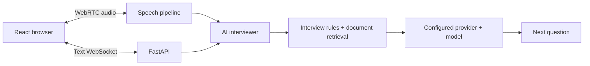

# Interview

**AI interview practice with answer-aware questions, resume retrieval, and a browser voice interface.**

Built by **Yash Jain** to explore the engineering behind an AI interviewer: real-time audio, model orchestration, retrieval, and structured feedback.

[Architecture](docs/architecture.md) · [Local setup](docs/getting_started.md) · [API](docs/api.md) · [Project status](docs/project_status.md)

## At a glance

| What | Why it matters |
|---|---|
| React interview workspace | Brings setup, conversation, and example feedback into one candidate journey. |
| FastAPI + WebSockets | Keeps text questions and answers on a persistent connection. |
| WebRTC audio pipeline | Connects browser audio to speech recognition, AI generation, and speech synthesis. |
| Resume and job retrieval | Grounds follow-up prompts in relevant document passages. |
| Configurable AI providers | Select one provider and model through server environment settings, with silent fallback disabled. |
| Rubric-based evaluation | Produces structured scores and written improvement suggestions. |

**Current stage: hosted practice app.** The lightweight FastAPI entry point supports role-specific AI interviews, document context, answer-aware follow-ups, and structured reports. Voice uses browser dictation and speech synthesis in the same session. Reports and preferences are saved in the browser. User accounts and cloud report storage are not implemented. See [deployment setup and limits](docs/deployment.md).

## Demo

**Walkthrough video: coming after the platform is completed.**

To explore the interface today, run the frontend below. Review dashboard → interview setup → live room → example report. The live room requires the backend and a working AI provider key; connection and provider failures are shown explicitly.

## How it works



The hosted path uses one interview WebSocket for typed and dictated answers. The original Whisper/WebRTC experiment is opt-in and is not part of the default deployment.

## Engineering highlights

- **Provider abstraction:** one shared service routes hosted and experimental paths to the selected model. Responses carry provider, model, text, and latency; failures never trigger silent fallback. See [model configuration](docs/model_configuration.md).
- **Focused context:** text documents are chunked and indexed with FAISS; the latest answer retrieves passages for follow-up prompts.
- **Explicit contracts:** WebSocket events drive text interaction; Pydantic models define evaluation output.
- **Clear boundaries:** transport, speech processing, prompts, retrieval, evaluation, and session state live in separate modules.

[Design decisions and trade-offs](docs/architecture.md#design-decisions) explain the costs and limits of these choices. No latency, accuracy, or scale benchmarks are claimed.

## Try the interface

Use a current Node.js LTS release compatible with the installed Vite version. The frontend lockfile records the dependency versions.

```bash
cd frontend/web
npm ci
cp .env.example .env
npm run dev
```

Open the local URL printed by Vite. For the hosted backend, install root `requirements.txt`, configure `.env` from `.env.example`, then run `uvicorn backend.api.main:app --reload`. No local speech model or retrieval index is needed. See [deployment](docs/deployment.md).

## Repository map

```text
frontend/web/       React + TypeScript interface
backend/api/        FastAPI application
backend/realtime/   WebRTC, WebSockets, speech pipeline, sessions
backend/ai/         Interviewer, model router, prompts, RAG, evaluation
backend/mcp/        In-process context host and providers
backend/memory/     In-memory session and evaluation state
tests/             Manual experiments; not a regression suite
docs/              Setup, contracts, design, and operations
```

The `mcp` directory is an in-process context abstraction; it does not implement the standard MCP wire protocol.

## Documentation

| Start here | Go deeper |
|---|---|
| [Setup and troubleshooting](docs/getting_started.md) | [Architecture](docs/architecture.md) |
| [API and event examples](docs/api.md) | [Retrieval](docs/rag_design.md) |
| [Current capabilities](docs/project_status.md) | [Voice pipeline](docs/realtime_pipeline.md) |
| [Validation](docs/testing.md) | [Context orchestration](docs/mcp_design.md) |
| [Deployment and operations](docs/deployment.md) | [Security and data handling](SECURITY.md) |

[Security](SECURITY.md) · [License status](docs/licensing.md)

**Author:** Yash Jain · AI systems and backend engineering
